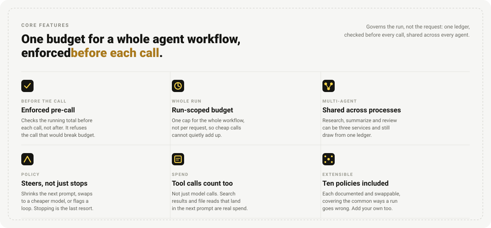
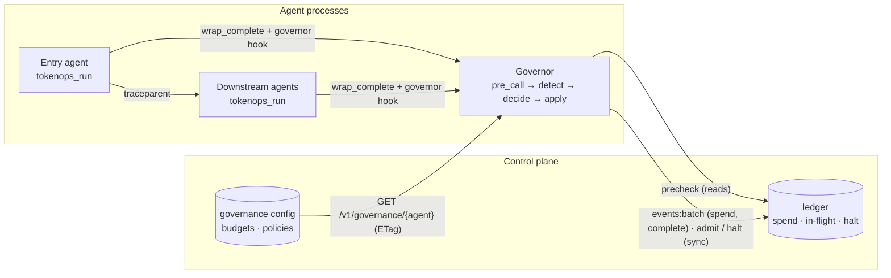

<div align="center">

# TokenOps

**Cuts wasted agent spend by up to `65%`, governing what the run has already spent before every call.**<br>
<sub>Toward token governance as a first-class discipline, not an afterthought.</sub>

[](https://pypi.org/project/agent-tokenops/)
[](https://pepy.tech/project/agent-tokenops)
[](LICENSE.txt)
[](https://github.com/theagentplane/tokenops/stargazers)
[](https://www.linkedin.com/company/the-agent-plane/)
[](https://github.com/theagentplane/tokenops/discussions)

[](https://www.linkedin.com/posts/microsoft-developers_who-spent-all-the-tokens-tokenops-gives-activity-7499191980715982848-224b)
[](https://commandline.microsoft.com/tokenops-real-time-run-scoped-cost-control-ai-agents/)
[](https://www.youtube.com/watch?v=GJX19pNhmSw)

<sub>Built by <b><a href="https://www.linkedin.com/in/susheemkoul/">Susheem Koul</a></b> and <b><a href="https://www.linkedin.com/in/tisha-chawla/">Tisha Chawla</a></b></sub>

<table><tr><td>


</td></tr></table>

<sub><i>See it stop a run mid-budget in the <a href="#-quickstart">Quickstart</a> below.</i></sub>

<br>

[Core features](#-core-features) · [Quickstart](#-quickstart) · [Quickdeploy](#-quickdeploy) · [How it compares](#-how-tokenops-compares) · [Policies](docs/policies/) · [Support](#-support) · [Contributing](#-open-to-contribution)

</div>

> ### 🙌 Open to contribution
>
> Token spend deserves the same first-class attention as compute or latency, and
> we are growing the community working on that. Policies, actuators, and the
> shared ledger are all open to extension. See
> **[CONTRIBUTING.md](CONTRIBUTING.md)** to get started.

## ✨ Core features

An AI agent's workflow can run up cost fast: dozens of small, individually
cheap steps that quietly add up to a surprisingly large bill. TokenOps sets
a single budget for the whole workflow and enforces it before every step,
so spending never gets away from you.



Ten policies ship configured in [`docs/policies/`](docs/policies/), and you can
add your own.

## 🚀 Quickstart

Requires Python 3.10+. Zero-setup taste: `python -m tokenops.demo` runs a governed
agent in process, no server and no keys. For your own agent in one process, pass a
governance config; to share one budget across processes, point every agent at a
control plane (see [Quickdeploy](#-quickdeploy) below):

### 1. Put it in your agent

> [!TIP]
> **Recommended.** Your coding assistant reads
> [`SKILL.md`](.claude/skills/integrate-tokenops/SKILL.md), wires the one
> enforcement point into your agent, and tells you what to check.

In **Claude Code**, from a clone:

```
/integrate-tokenops
```

Anywhere else (Cursor, Copilot, ...), paste this:

> Integrate TokenOps into this agent, following
> https://github.com/theagentplane/tokenops/blob/main/.claude/skills/integrate-tokenops/SKILL.md

<details>
<summary><b>Manual</b>, about ten lines</summary>

Wrap your model call once, then hand the wrapped version to your agent.

```python
from tokenops import tokenops_run
from tokenops.control import Halt, wrap_complete
from tokenops.providers import complete

GOVERNANCE = {"governance": {
    "budgets": [{"id": "run_llm_cap", "limit_micros": 2_000_000, "dimension": "trace"}],
    "policies": {"cost_budget": {"budget": "run_llm_cap"},
                 "pre_call_worst_case": {"budget": "run_llm_cap"}},
}}

with tokenops_run(config=GOVERNANCE, service="my-agent", intent="research",
                  provider="openai", model="gpt-4o") as bound:
    governed = wrap_complete(
        bound.governor, bound.controls, bound.attr,
        provider="openai", model="gpt-4o",
        dispatch=complete, service="my-agent",
    )
    try:
        agent.run(..., complete_fn=governed)   # <-- pass `governed`, not `complete`
    except Halt as stopped:
        print(f"run stopped: {stopped}")
```

Pass `governed` to your agent instead of `complete`; nothing else changes.
`wrap_complete` checks the budget before each call and raises `Halt` when the
run is out. With a control plane, replace `config=GOVERNANCE` with
`client=ControlPlaneClient.from_env()` (`from tokenops.repositories import
ControlPlaneClient`); the budget then lives in the plane and is shared across processes.

</details>

### 2. When you need more

| You want to | Go to |
|---|---|
| Change the budget | [Set the budget](.claude/skills/integrate-tokenops/SKILL.md#set-the-budget) |
| One budget across several agent processes | [Shared plane](.claude/skills/integrate-tokenops/SKILL.md#tier-2--several-processes-one-budget) |
| FastAPI or A2A services | [Instrumented app](.claude/skills/integrate-tokenops/SKILL.md#tier-3--fastapi--a2a) |
| Something other than stopping | [The ten policies](docs/policies/) |
| Cost per agent in a dashboard | [Quickdeploy](#-quickdeploy) |
| Coming from 0.4 | [Migration](docs/migration-0.4-to-1.0.md) |
| Everything else | [Onboarding guide](docs/guides/onboarding.md) |

### 3. See it in action

<table><tr><td>

<a href="https://github.com/theagentplane/tokenops/raw/main/examples/demo-assets/videos/02_governance_on_budget_cap.webm">

</a>

</td></tr></table>

<sub><i>Same task, run twice: ungoverned it completes over budget, governed it halts within the cap, then the Dashboard attributes cost per agent. <a href="https://github.com/theagentplane/tokenops/raw/main/examples/demo-assets/videos/02_governance_on_budget_cap.webm">Full video</a>.</i></sub>

## 🐳 Quickdeploy

> [!NOTE]
> TokenOps does not ship its own control plane or UI. Governance configuration, the shared
> ledger and the run list live in the AgentPlane
> [control plane](https://github.com/theagentplane/control-plane); its web page has a TokenOps
> tab for budgets, policies and halted runs.

```bash
pip install agentplane-control-plane
control-plane serve                      # see its README for the Docker image and deployment
export CONTROL_PLANE_URL=http://localhost:8000
export CONTROL_PLANE_API_KEY=...         # on every agent: read + ingest scopes
```

Put a budget there with `control-plane db seed --file my.yaml`, or through its API
(`PUT /v1/budgets`, `PUT /v1/policies`). Every agent pulls it, `ETag` cached.

PyPI name is `agent-tokenops`; the import is `tokenops`. Extras:
`pip install "agent-tokenops[examples]"` for the LangChain examples. Releases:
[`RELEASING.md`](RELEASING.md).

## 🆚 How TokenOps compares

TokenOps is not a gateway or a tracing dashboard. It governs the **run**, a full agent workflow, and sits alongside the tools you already use for routing and observability.

| | TokenOps | LiteLLM / Portkey / AI Gateway | Langfuse |
|---|:---:|:---:|:---:|
| Primary focus | Run | Request | Trace |
| Multi-agent workflow as one unit | Yes | No | Partial |
| Budget enforcement in-path | Yes | Yes | No |
| Steer next call (mutate / inject) | Yes | Partial | No |
| Shared ledger across processes | Yes | — | — |

What this does **not** do: replace your LLM gateway, replace [Chronicle](https://github.com/theagentplane/chronicle)'s record-and-replay, or host a SaaS control plane for you.

Longer table with logos: [`docs/product/comparison.md`](docs/product/comparison.md).

## Reference

Things you will want eventually, not now.

<details>
<summary><b>Architecture: how the control plane, Chronicle and TokenOps split the work</b></summary>

Three pieces share one artifact, the **run**, which is a Chronicle trace (`trace_id`):



| Piece | Owns | Does not own |
|---|---|---|
| **Control plane** | configuration, the shared ledger, traces, the web page | the decision to stop a call |
| **Chronicle** | the trace, recording, replay, propagation | cost, budgets, policies |
| **TokenOps (this package)** | the governors: policies, pricing, the ledger view, the hook | a server, a database, a UI |

See [`docs/architecture.md`](docs/architecture.md). Chronicle is accepted at
[REALM](https://realm-workshop.github.io/) (Research on Agent Language Models), a workshop at EMNLP 2026.

</details>

<details>
<summary><b>Environment variables</b></summary>

| Variable | Purpose |
|---|---|
| `CONTROL_PLANE_URL` | The control plane's base URL (for example `http://localhost:8000`). Required for `ControlPlaneClient.from_env()` |
| `CONTROL_PLANE_API_KEY` | Bearer key (scopes `read`, `ingest`; `admin` to write configuration) |
| `CHRONICLE_CONTROL_PLANE_URL`, `CHRONICLE_API_KEY` | Where Chronicle saves envelopes; set the same plane |

There is no local ledger fallback. With a plane configured every process shares one budget;
without one, pass `config=` and the ledger lives in the process.

</details>

<details>
<summary><b>Make targets</b></summary>

| Target | Role |
|--------|------|
| `make install` | Editable install with dev + examples extras |
| `make dist` / `check-dist` | Build sdist+wheel / `twine check` |
| `make demo-quick` | `python -m tokenops.demo`: no API keys, no server |
| `make sync-skills` | Regenerate the editor copies of the integration skill |

</details>

<details>
<summary><b>Project structure</b></summary>

Only `src/tokenops/` is the installable package. Demos and benches stay under `examples/`.

```
src/tokenops/              # installable package
├── control/               # the governors: ledger, policies, wrap_complete, Chronicle hook
├── repositories/          # the control-plane client and the background ledger writer
├── providers/             # OpenAI / Anthropic complete dispatch
└── config/                # packaged default governance
examples/                  # A2A agent stacks (being rewritten)
docs/                      # architecture, policies, ADRs, migration
tests/                     # unit, contract and end-to-end (real control plane)
```

</details>

<details>
<summary><b>More documentation</b></summary>

- [Onboarding](docs/guides/onboarding.md): prerequisites, minimum integration, FAQ, current limits
- [Migrating from 0.4](docs/migration-0.4-to-1.0.md)
- [Architecture](docs/architecture.md) - [trace attribution](docs/trace-attribution.md) - [halt](docs/halt.md)
- [Policies](docs/policies/): one page per policy - [decisions](docs/adr/README.md)
- [Examples](examples/README.md) - [comparison](docs/product/comparison.md)

</details>

## 📰 Talks & press

- **Featured by Microsoft Developer**: “Who spent all the tokens?” on
  [LinkedIn](https://www.linkedin.com/posts/microsoft-developers_who-spent-all-the-tokens-tokenops-gives-activity-7499191980715982848-224b) and [X](https://x.com/msdev/status/2093425027500978292).
- **[Who spent all the tokens? Real-time, run-scoped cost control for AI agents](https://commandline.microsoft.com/tokenops-real-time-run-scoped-cost-control-ai-agents/)**: *Command Line*, a Microsoft publication.
- **[FinOps for AI Agents: Who Spent All the Tokens?](https://www.youtube.com/watch?v=GJX19pNhmSw)**: talk at the **AI Engineer World's Fair**, San Francisco.

## 🛟 Support

| Need | Where |
|---|---|
| Bug | [Open an issue](https://github.com/theagentplane/tokenops/issues) |
| Security issue | [SECURITY.md](SECURITY.md) |
| Real-time help | [Slack](https://join.slack.com/t/theagentplane/shared_invite/zt-47lqx2xtc-0idr1cuLNJ_JDTgqxDiUsg) |
| Longer-form discussion | [GitHub Discussions](https://github.com/theagentplane/tokenops/discussions) |
| Talk it through | [Office hours](https://calendly.com/theagentplane/theagentplane) |
| Talks & writing | [theagentplane.github.io/media](https://theagentplane.github.io/media.html) |

## Contributors

Thanks to everyone who has contributed.

[](https://github.com/theagentplane/tokenops/graphs/contributors)

---

Saved you tokens? [⭐ Star the repo](https://github.com/theagentplane/tokenops).

<div align="center">

[Back to top](#tokenops)

</div>
