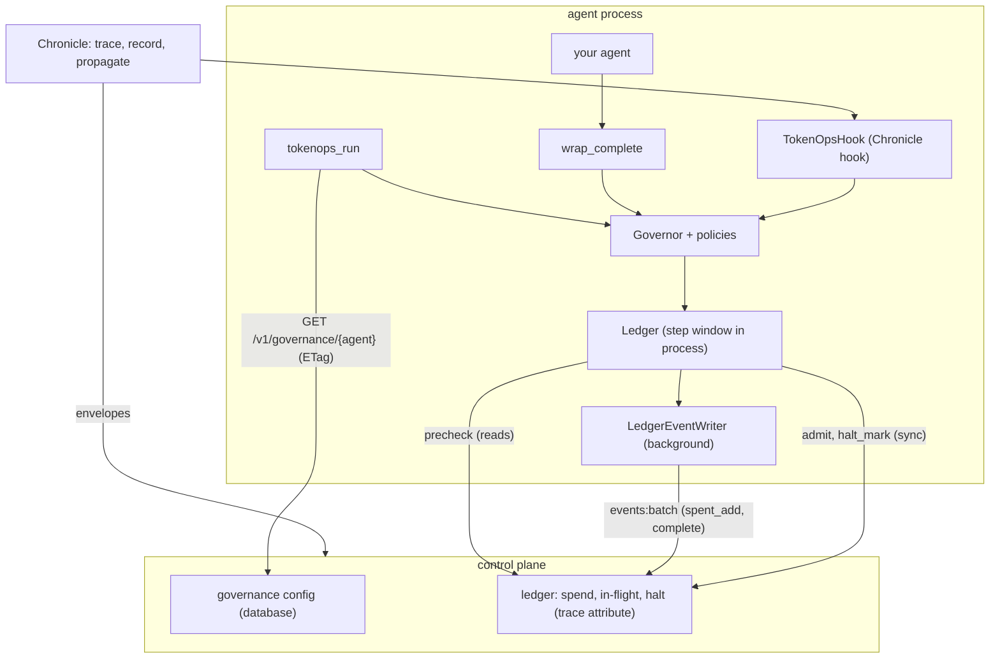

# Architecture

Where the code starts, how the pieces depend on each other, and what each is for.

TokenOps is the **governor**: it decides, inside an agent's own process, whether the next
model call may happen. It stores nothing itself. Configuration and the shared ledger live in
the AgentPlane [control plane](https://github.com/theagentplane/control-plane); recording and
trace identity come from [Chronicle](https://github.com/theagentplane/chronicle); the shared
data model is [primitives](https://github.com/theagentplane/primitives).

## The three pieces

| Piece | Owns | Does not own |
|---|---|---|
| **Control plane** | Governance configuration (budgets, policies, segments), the shared ledger (spend, in-flight, halt), traces and the web page | The decision to stop a call |
| **Chronicle** | The trace (a run is a trace), recording, replay, propagation across services | Cost, budgets, policies |
| **TokenOps (this package)** | The governors: policies, pricing, the ledger view, the hook that runs them | A server, a database, a UI |

## Starting points (what you call)

| Entry point | Module | Purpose |
|---|---|---|
| `tokenops_run` / `instrument_app` | `capabilities/run.py`, `interfaces/instrument.py` | join the trace, build attribution, load governance, bind the governor |
| `wrap_complete`, `wrap_stream` | `capabilities/complete_wrapper.py` | the pre-call gate, message rewrite and retry around the model call |
| `TokenOpsHook` | `capabilities/crossing.py` | the Chronicle hook: pre-call, admit/complete, observe |
| `ControlPlaneClient` | `repositories/control_plane_client.py` | the control-plane HTTP client (governance, precheck, events, halt) |
| `LedgerEventWriter` | `repositories/ledger_event_writer.py` | background, ordered ledger writes |
| `build_governor(config, price)` | `framework/config.py` | `budgets:`/`policies:` dict to a wired `Governor` |
| `Ledger` | `framework/ledger.py` | spend, in-flight and halt (plane-backed) and the in-process step window |

## Data flow

## Runtime flow of one governed call

1. `tokenops_run` joins the Chronicle trace of the active span (or the inbound
   `traceparent`), builds the hop's attribution from its own `intent`, `user_dims` and `mode`,
   and pulls governance for the agent (or uses `config=`).
2. `wrap_complete`: `pre_call` runs the detectors (`pre_call_worst_case`,
   `concurrency_cap`, ...). A `Halt` here means the call never starts.
3. The prompt is rewritten if a policy asked (carry, `context_compaction`).
4. `ledger.admit` (synchronous), then the dispatch through Chronicle `wrap_llm`, which records
   the call and runs the hook.
5. The hook's `crossing` event turns the result into an `Observation`; the ledger prices it and
   queues a `spent_add`; the observe-side detectors (`cost_budget`, `step_cap`, ...) run.
6. `ledger.complete` is queued. If a policy retries, the loop repeats from step 4.

State by lifetime:

| State | Scope | Where |
|---|---|---|
| Spend, in-flight, halt | across processes, per trace | the control plane (`precheck`, `events:batch`) |
| Step window, local step count, velocity | per process, per trace | in memory (`LocalRunState`) |
| Governance configuration | across processes | the control plane, `ETag` cached per client |

## Design rules

- **Dependencies point one way.** The data plane never imports control internals except the hook.
- **The control plane owns configuration.** The agent pulls it; nothing is written locally.
- **Fail closed.** No governance and no plane raises rather than running ungoverned; an unknown
  price or an unknown policy template refuses.
- **No double counting.** The plane does not deduplicate ledger events, so a write whose outcome
  is unknown is never retried ([ADR 0002](adr/0002-ledger-writes-are-attempted-once.md)).
- **Architecture decisions are ADRs** in [`docs/adr/`](adr/README.md).

See also [trace attribution](trace-attribution.md), [halt](halt.md) and
[concurrency](concurrency.md).
